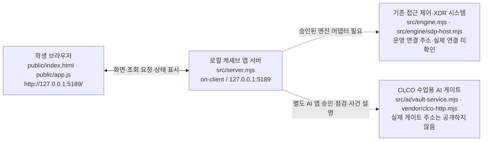

# 케셰브(KESHEV) — 학생 실행 설명서와 시스템 구성도 (21단계)

> **범위:** 이 문서는 학생이 작업한 케셰브 프로젝트의 실행 절차, 구성 경계, 현재까지의 검증 결과와 미확인 항목을 기록한다. 제공된 README·서버·공통 UI·인증 설정을 수정하지 않는다. 작성 기준은 GitHub `main`의 20단계 커밋 `b7d6250373ebeef9ea68113883af1d9cd0273265` 및 학생이 PowerShell·브라우저에서 직접 확인한 결과다. 이후 커밋의 실제 내용과 달라지면 다시 대조해야 한다.

## 1. 목적과 기능

케셰브는 회사 직원이 **자신의** 로그인·기기·세션 상태, 업무 앱 접근 판정, 접속 기록과 XDR 경보를 확인하도록 만든 로컬 브라우저 보안 앱이다. AI 게이트가 사용 가능할 때 사건 설명을 제공하지만, AI 설명이나 조치 제안만으로 실제 보안 조치를 실행하지 않는다. 알려진 패키지 취약점 조회는 운영자가 승인한 공개 패키지에 한정된다.

- **제공 UI**: 화면·탭, 서버 요청, 응답 검사, AI 승인 흐름과 상태 관리, 요청 취소, 조치의 사람 확인 버튼 등을 제공한다.
- **학생 작성 UI**: `student/extension.mjs`의 `render*` 함수가 **받은 현재 상태를 표시**한다. 보안 서버 판정이나 인증·집행을 새로 수행하지 않는다.
- **기본 연결 상태**: 별도의 승인된 보안 엔진 설정 없이 실행하면 `disconnected`일 수 있다. 앱이 열렸다는 사실은 기존 서버·XDR·AI 또는 OSV의 연결 성공을 의미하지 않는다.

## 2. 지원 환경과 실제 확인 버전

| 항목 | 확인한 값 또는 지원 범위 | 확인 근거·한계 |
|---|---|---|
| 운영체제·셸 | Windows PowerShell **5.1** | 학생이 실행한 셸 출력 |
| Node.js 실제 실행 버전 | **v24.20.0** | `start-alekov.ps1`의 사용자 실행 로그 |
| Node.js 지원 범위 / 수업 기준 | **22~24 / v24.19.0** | `tools/start-alekov.ps1`, `docs/STUDENT_LAUNCH_GUIDE.md`; 실제 v24.20.0 실행 시 기준 버전 안내만 나옴 |
| 앱 패키지 메타데이터 | `name: alekov-client-starter`, `version: 0.2.14`, `type: module` | `on-client/package.json` |
| 외부 npm 의존성 | 시작 틀 `package.json`에 외부 의존성 명시 없음 | 별도 `npm install`은 기존 실행에서 요구되지 않음 |
| `package-lock.json` | **GitHub의 해당 커밋에서 파일 존재를 확인하지 못함** | 실제 로컬 파일 유무·설치 의존성은 미확인; 내용을 추측하지 않음 |
| 기본 접속 주소 | `http://127.0.0.1:5189/` | 사용자 화면 확인·실행 도구 |
| GitHub 저장소 | `https://github.com/bonsago123-cloud/keshev_security_agent` | 사용자 실제 커밋·푸시 기록 |

다른 운영체제의 실행이나 운영 서버 환경은 확인하지 않았다. `node_modules`나 패키지 버전을 임의로 설치·변경하지 않는다.

## 3. 실제 작업 폴더와 파일 구조

- **Git 최상위(프로젝트 폴더)**: `C:\Users\User\AppData\Local\ALEPH\Workbench\projects\keshev_security_agent`
- **앱 폴더**: `C:\Users\User\AppData\Local\ALEPH\Workbench\projects\keshev_security_agent\on-client`
- **학생 설명서(이 문서)**: `on-client/docs/STUDENT_RUNBOOK.md`

```text
keshev_security_agent/                # Git 최상위: 커밋·제출 준비 위치
└─ on-client/                         # 앱 실행 위치
   ├─ package.json                   # 앱 메타데이터·npm 스크립트
   ├─ .env.example                   # 비밀 없는 설정 예시; 비밀값 넣지 않기
   ├─ .on-starter-manifest.json      # 제공 파일 목록·원천 해시
   ├─ tools/
   │  └─ start-alekov.ps1           # PowerShell 실행 도구
   ├─ public/
   │  ├─ index.html                 # 제공 화면과 버튼
   │  ├─ app.js                     # 제공 화면의 요청·상태·학생 함수 연결
   │  ├─ ai-connect.mjs             # 제공 AI 승인 화면 흐름
   │  └─ vulnerabilities-view.mjs   # 제공 OSV 조회 결과 화면
   ├─ src/
   │  ├─ server.mjs                 # 127.0.0.1에 바인딩하는 로컬 HTTP 서버
   │  ├─ engine.mjs                 # 보안 엔진 연결·기본 미연결·예제 구분
   │  ├─ engine/sdp-host.mjs        # 기존 SDP 호스트 연동 경계
   │  ├─ ai/vault-service.mjs       # 앱 전용 AI 자격 사용 경계
   │  ├─ actions/service.mjs        # 제공 조치 처리 경계
   │  └─ vulnerabilities/project-scan.mjs # 설치 메타데이터·OSV 조회
   ├─ student/
   │  ├─ extension.mjs              # 학생이 구현한 표시 함수 8개
   │  └─ engine-adapter.mjs         # 제공 연결용 어댑터 틀(임의 수정 금지)
   ├─ vendor/clco-http.mjs          # 게이트 HTTP 클라이언트
   └─ docs/
      ├─ STUDENT_LAUNCH_GUIDE.md    # 기존 제공 실행 안내(수정하지 않음)
      ├─ CONNECTION_TROUBLESHOOT.md # 기존 제공 오류 안내(수정하지 않음)
      ├─ STUDENT_PROMPTS.md         # 기존 공식 단계별 안내(수정하지 않음)
      └─ STUDENT_RUNBOOK.md         # 이 단계에서 추가한 학생 문서
```

위 구조는 현재 GitHub에서 확인한 주요 파일만 발췌했다. 프로젝트의 모든 폴더·파일을 나열한 것은 아니다. 인증서·개인키·설정 내용·비밀번호·API 키는 프로젝트 문서와 커밋에 넣지 않는다.

## 4. PowerShell에서 켜기·확인·끄기·다시 켜기

**실행을 확인한 명령**: `on-client` 폴더의 Windows PowerShell에서 다음을 실행한다.

```powershell
Set-Location -LiteralPath "C:\Users\User\AppData\Local\ALEPH\Workbench\projects\keshev_security_agent\on-client"; powershell -NoProfile -ExecutionPolicy Bypass -File .\tools\start-alekov.ps1
```

파일 탐색기에서 위 `on-client` 폴더를 열고 주소창에 `powershell`을 입력해 새 PowerShell을 열어도 된다. 다른 사용자는 **자신에게 실제 존재하는 프로젝트 경로**로 이동해야 하며, 이 명령의 `C:\Users\User` 경로를 모든 PC에 공통인 경로로 가정하지 않는다.

1. **준비 확인:** Windows PowerShell을 열고 Node.js 22~24가 준비됐는지 `node -v`로 확인한다. 이 명령은 수업 자료의 Node 버전 확인을 위한 것으로, 사용자가 실행한 버전은 v24.20.0이다.
2. **실행:** 위 명령을 붙여 넣는다. 실행 도구는 없는 프로그램을 설치하지 않고, 외부 포트 점유 프로세스를 종료하지 않는다.
3. **정상 시작 신호:** `케셰브가 켜졌습니다. 브라우저에서 http://127.0.0.1:5189/ 을 여세요.`와 `서버가 응답한 것만 확인했습니다. AI 연결 상태는 화면에서 따로 확인해 주세요.`가 나오는지 확인한다. 이는 **로컬 서버 HTTP 응답 확인**이며 AI·기존 보안 엔진 연결 성공이 아니다.
4. **브라우저:** `http://127.0.0.1:5189/`를 열어 `보호 현황`, `업무 앱`, `보안 기록` 탭과 상태 문구를 확인한다. 서버 연결이 없으면 `연결 없음`이 나타날 수 있다.
5. **종료:** 실행 중인 **그 PowerShell 창**에서 `Ctrl+C`를 누른다. 백그라운드 실행을 선택한 경우에는 실행 도구의 프로세스 번호와 공식 제공 안내를 따른다.
6. **재실행:** 종료를 확인한 뒤 같은 앱 폴더에서 같은 실행 명령을 사용하고 브라우저를 새로고침한다. 기존 Git 작업·학생 코드는 지우지 않는다.

### 포트 5189를 이미 사용 중이라면

사용자 실행 로그에서 `포트 5189 를 다른 프로그램이 쓰고 있습니다`가 나타난 적이 있다. 먼저 기존 케셰브가 열려 있는지 `http://127.0.0.1:5189/`에서 확인한다. 기존 서버가 정상이라면 **중복 실행하지 않는다**. 다른 프로그램이 포트를 쓰고 있는 경우 기존 프로그램을 종료하지 말고, **이미 제공된** 다음 옵션을 사용할 수 있다(이 대체 포트 실행의 사용자 실제 성공 여부는 미확인).

```powershell
powershell -NoProfile -ExecutionPolicy Bypass -File .\tools\start-alekov.ps1 -Port 5190
```

이 경우 브라우저 주소도 `http://127.0.0.1:5190/`로 바꾼다. 포트만 바꿨다고 보안 데이터나 AI 권한이 연결되는 것은 아니다.

### 명령과 위치의 구분

| 작업 | PowerShell을 여는 위치 |
|---|---|
| 케셰브 실행·종료·재실행 | `on-client` 앱 폴더 |
| Git 변경 확인·커밋·푸시 | `keshev_security_agent` 프로젝트 최상위 |
| 21·22단계 비공개 원문 전달 CLI | **과제 화면의 공식 절차**에 따라 프로젝트 최상위; CLI 도구·JSON 출력은 프로젝트 밖 |

PowerShell의 `npm.ps1`이 실행 정책에 막히는 환경에서는 검증된 `start-alekov.ps1` 실행 명령을 사용한다. 제공된 `package.json`의 `npm start`와 `npm run check` 스크립트가 존재한다는 사실은 코드로 확인했지만, 이 학생 환경에서 두 npm 명령을 실제로 실행했는지는 확인되지 않았다.

## 5. 글로 쓴 시스템 구성도



**같은 내용을 글로 설명하면 다음과 같다.**

| 구성요소 | 실제 파일·공개 가능한 주소 | 역할과 확인 상태 |
|---|---|---|
| 학생 브라우저 | `on-client/public/index.html`, `public/app.js`; `http://127.0.0.1:5189/` | 화면·탭·제공 버튼을 표시하고 로컬 서버에 요청한다. 로컬 화면 표시 **확인** |
| 케셰브 로컬 앱 서버 | `on-client/src/server.mjs`; `127.0.0.1:5189` | 제공 HTTP API, 연결 상태·검증된 결과 전달. 사용자 브라우저 접속 **확인** |
| 기존 접근 제어·XDR 시스템 | `on-client/src/engine.mjs`, `src/engine/sdp-host.mjs` | 승인된 SDP 어댑터를 통해 로그인·판정·보안 사건을 제공하도록 설계. 사용자 확인에서는 **`disconnected` / `ENGINE_NOT_CONNECTED`**, 실연동 미확인 |
| CLCO 앱 전용 AI 게이트 | `on-client/src/ai/vault-service.mjs`, `vendor/clco-http.mjs` | 앱 서버를 거쳐 AI 앱 승인·모델 점검 및 별도 사건 설명 호출. 이전 사용자 화면에서 `verified`, 모델 1개 **연결 점검 확인**; 실제 사건 설명 생성 **미확인** |

`on-client/student/extension.mjs`는 서버·외부 시스템을 직접 연결하는 게 아니라, 제공 `public/app.js`가 넘긴 현재 상태를 DOM의 `textContent`로 보여 준다. 외부 OSV 조회는 별도 경로 `src/vulnerabilities/project-scan.mjs` → 공개 OSV API `https://api.osv.dev/v1/querybatch`에 해당하며, 승인된 공개 패키지와 실제 설치 버전 확인을 전제로 한다. **현재 프로젝트 설정이 없어 실제 OSV 취약점 결과는 미확인**이다. 공식 과제 판정 AI와 Workbench 코딩 지원 AI는 이 앱 내부 설명 AI와 역할이 다르다.

## 6. 학생 함수와 제공 코드의 경계

제공 파일의 보호 범위는 `.on-starter-manifest.json` 및 제공 안내를 기준으로 한다. **학생 파일 `student/extension.mjs`만 앞 단계에서 구현·커밋했으며**, 본 21단계에서는 새 학생 문서만 작성한다.

| 단계 | `student/extension.mjs` 학생 함수 | 학생 표시 기능 / 실제 확인 범위 |
|---|---|---|
| 13 | `renderIdentity` | 현재 로그인·기기·세션과 미연결 상태를 구분. 코드 확인, 현재 운영 데이터 응답은 미확인 |
| 14 | `renderDecision` | 업무 앱 접근 허용·거부·추가 확인·확인 불가·오류 구분. 코드 확인, 실제 업무 앱 판정 미확인 |
| 15 | `renderEvents` | 접속/XDR 사건, 근거·규칙·상태 표시. 코드 확인, 실제 사건 데이터 수신 미확인 |
| 16 | `renderStatus` | 기기·세션·알림, 오류·진단 도움정보 구분. 코드 확인, 운영 엔진 응답 미확인 |
| 17 | `renderAiConnection` | `idle/loading/ok/error`, `test/verified`, `modelCount`·`checkedAt` 구분. 사용자 실제 화면에서 `verified`·모델 1개 확인; 사건 설명 호출과 별개 |
| 18 | `renderExplanation` | AI 요약과 실제 사건 근거 ID·규칙·`unknown`·미실행 제안 연결. 모의 검사 및 실제 초기 사건 미선택 안내 확인; 실제 AI 사건 설명 미확인 |
| 19 | `renderAction` | `prepared/executing/pending/succeeded/unknown` 등, 사람 확인·ACK·관측 효과 구분. 모의 검사 및 실제 `idle` 화면 확인; 집행·효과 관측 미확인 |
| 20 | `renderVulnerabilities` | 정확한 설치 버전, OSV ID·시각·출처, `complete/partial/not_checked/not_configured/unverifiable` 구분. 모의 검사 및 실제 `idle`, `not_configured` 화면 확인 |

**제공 코드가 담당하는 것:** `public/app.js`의 상태 수집·취소/세대 관리, 제공 `public/index.html`의 버튼, `src/server.mjs`의 HTTP API, `public/vulnerabilities-view.mjs`의 검증된 조회 표시, `src/`의 엔진·AI·조치 서비스. 학생 표시 함수는 새로운 POST 요청이나 조치 실행 버튼을 추가하지 않는다. 실제 조치 집행·요청 접수(ACK)·효과 관측은 다른 상태이며 `succeeded`와 `observation.effectApplied === true`일 때만 효과 확인으로 표시한다.

## 7. 확인된 결과 / 미확인 항목

| 항목 | 구분 | 근거와 해석 |
|---|---|---|
| 로컬 웹 UI `http://127.0.0.1:5189/` | 실제 화면 확인 | 사용자가 케셰브 브라우저 화면을 제공함 |
| 계정 연결·AI 앱 승인 | 실제 화면 확인 | 별도 사용자 화면에서 완료 표시를 확인함; 이후 계정·권한의 지속성은 보장하지 않음 |
| 앱 AI 모델 점검 | 실제 화면 확인 | 한 시점 `verified`, 모델 1개. **사건 설명 호출 성공 아님** |
| 18단계 사건 미선택 안내 | 실제 화면 확인 | `보안 기록에서 기록을 먼저 고르세요` 표시 |
| 19단계 조치 미실행 상태 | 실제 화면 확인 | `idle` 표시, 실제 보안 조치 미실행 |
| 20단계 패키지 조회 | 실제 화면 확인 | `not_configured`, `PROJECT_NOT_CONFIGURED`, `checkedAt: 2026-11-20T01:07:00.250Z`; 공개 OSV 요청 결과 아님 |
| 17~20 학생 표시 로직 | 사용자 제공 PowerShell 로그·모의 검사 | 17단계 30개, 18단계 28개, 19단계 38개, 20단계 34개 검사 통과 보고. 실제 운영 서버 검증과 별개 |
| 기존 SDP 엔진 사건 조회·업무 앱 판정 | **미확인(UNV)** | `ENGINE_NOT_CONNECTED`, `mode: disconnected` 확인; 실제 시스템 연결·응답 확인 못함 |
| 실제 사건 AI 설명 | **미확인(UNV)** | 사건 목록이 연결되지 않아 생성 호출 성공 검증 불가 |
| 실제 조치 집행·ACK·효과 재조회 | **미확인(UNV)** | 원천 지원 조치 빈 배열, 실제 집행 요청하지 않음 |
| 정확한 설치 패키지에 대한 OSV 취약점 조회 | **미확인(UNV)** | `PROJECT_NOT_CONFIGURED`; 취약점 없음으로 판단하지 않음 |
| 새 PowerShell 창에서 이 문서만으로 제3자 재실행 | **미확인** | 21단계 문서 작성 뒤 사용자가 다시 실습해야 함 |
| ALEPH 21단계 공식 판정 | **미확인** | 학생 문서·커밋 제출 뒤 서버 판정 별도 확인 |

모의 검사가 통과했다는 사실은 실제 SDP·유료 AI·조치 권한·OSV 조회가 성공했다는 증거가 아니다. 기본 예제(`demo`)는 실제 운영 연동이 아니다.

## 8. 장애·오류별 확인 순서

| 증상·오류 | 정확한 의미 | 사용자가 할 일 / 하지 않을 일 |
|---|---|---|
| `Node.js 가 없습니다` / 지원 범위 밖 버전 | 런타임을 시작할 수 없음 | 공식 안내에 맞는 Node.js 22~24를 준비. 수업 기준은 24.19.0. 임의 버전 설치 성공을 기록하지 않음 |
| `지금 Node.js 는 v24.20.0` | 수업 기준과 다른 버전 안내 | 이 버전으로 실행을 시도한 기록이 있음. 안내 자체가 앱 실패는 아님 |
| `포트 5189 를 다른 프로그램이 쓰고 있습니다` | 5189 포트 점유 | 기존 앱이 켜져 있는지 먼저 확인, 필요시 공식 `-Port 5190`. 다른 프로그램 강제 종료 금지 |
| `ENGINE_NOT_CONNECTED` / `disconnected` | 기존 접근 제어·XDR 엔진 연결 없음 | 앱을 켰다는 이유로 연결 성공 처리하지 않음. 운영자가 발급한 SDP 연결 설정 여부를 확인; 서버·설정·인증을 임의 수정하지 않음 |
| `ON_AI_PROVISIONING_PENDING` | AI 앱 이용 권한 준비 중·확인 불가 | 계정 연결·AI 승인 상태를 확인하고 담당자에게 권한 확인 요청. API 키 요구·복사 금지 |
| `WB_CLCO_AUTH_REQUIRED` / `WB_CLCO_ACCESS_BLOCKED` | AI 인증 실패·접근 제한 | 같은 계정 연결 확인, 담당자에게 상태 문의; 성공으로 표시하지 않음 |
| `WB_CLCO_LIMIT_REACHED` / `WB_CLCO_COHORT_BUDGET_EXHAUSTED` | AI 이용 한도·반 사용량 소진 | 담당자에게 확인하고 반복 요청하지 않음 |
| `WB_CLCO_TIMEOUT` / `WB_CLCO_NETWORK_ERROR` | AI 게이트 지연·네트워크 문제 | 상태 확인 후 사용자가 직접 재점검. 자동 반복 호출 금지 |
| `unknown` / `ACTION_RESULT_UNVERIFIED` | 조치 실제 결과를 확인할 수 없음 | 성공·효과 없음 모두 단정하지 않음. 제공 UI의 `원천 결과만 재조회`만 안내; 임의 집행 금지 |
| `PROJECT_NOT_CONFIGURED` / `not_configured` | OSV 조회 대상 프로젝트 설정 없음 | 담당자 설정 필요. 미조회이지 취약점 없음 아님 |
| `NO_APPROVED_PACKAGES` / `not_checked` | 승인된 공개 패키지 조회 대상이 없음 | 미조회로 표시, 승인 목록을 학생이 임의 수정하지 않음 |
| `unverifiable` / `partial` | lock 파일·설치 메타데이터 또는 일부 조회 결과 확인 불가 | 확인된 ID는 유지하고 실패·미확인 범위를 구분. 안전 보장으로 표시하지 않음 |
| `CANCELLED` / `TIMEOUT` | 취소 또는 응답 시간 초과 | 이전 결과를 현재 결과처럼 보이지 않게 하고, 필요하면 사용자가 직접 재조회 |

화면에서 실패 문구가 보이면 우선 **보호 현황 → 도움정보 → 도움정보 불러오기**로 안전한 진단을 확인한다. 비밀값이나 설정 파일 원문은 복사·제출하지 않는다. 네트워크 장애 공지나 외부 인프라 경고를 봤더라도, 그 알림과 케셰브 로컬 오류의 인과관계는 별도 근거 없이 확정하지 않는다.

## 9. 21단계 커밋·원문 제출 안내(이번 공식 과제 화면 기준)

1. 제공 README나 `src/`, `public/app.js`를 수정하지 않고 **이 학생 문서만 추가**한다. 이번 단계의 다른 학생 코드 변경이 없다면 학생 문서 자체가 21단계 변경 파일이다. 기존 미커밋 수정·새 파일은 그대로 보존한다.
2. 이 문서를 따라 **새 PowerShell 창**에서 앱을 다시 실행하고 경로·버전·버튼 이름·출력 문구를 실제로 확인한다. 미확인 항목을 성공으로 바꿔 쓰지 않는다.
3. Git 최상위 프로젝트 폴더에서 이번 단계의 **해당 학생 문서만** 변경 목록을 확인해 커밋하고, 커밋된 실제 40자리 SHA를 확인한다. 다른 사람이 만든 파일을 자동으로 포함하지 않는다. 비밀 원문은 절대 커밋하지 않는다.
4. **21·22단계:** ALEPH 과제 화면에 저장소 주소와 해당 40자리 커밋을 **직접 입력**한다. 기존 `docs/STUDENT_LAUNCH_GUIDE.md`의 워크벤치 제출 준비 설명은 13~20단계 중심이므로, 이번 과제 화면의 최신 안내를 우선한다.
5. 저장소가 비공개이고 과제 화면이 원문 묶음을 요구하면, 해당 단계의 **`비공개 저장소 원문 준비 방법`**을 열어 **`원문 전달 도구 받기`**를 선택한다. CLI ZIP과 출력 JSON은 **프로젝트 밖**에 두고, Git 최상위 폴더에서 과제 화면이 제공한 `student-source-cli.mjs`의 **실제 명령**을 사용한다. `--commit` 뒤에는 실제 커밋 40자리 SHA를 넣는다. 도구·출력 경로는 본인 PC 기준으로 바꾼다. **과제 화면에서 확인하지 않은 CLI 명령은 추측하여 적지 않는다.**
6. 생성한 JSON을 해당 단계의 **`비공개 저장소 원문 묶음`**에서 선택하고, 저장소·커밋·단계를 대조한 뒤 사용자가 직접 제출한다. 원문 전달 완료와 AI 공식 판정 통과는 별도 상태다. 원문만 실패하면 공식 안내의 **`원문만 다시 보내기`**를 이용한다.

**미실행:** 이 문서 작성 단계에서는 새 커밋·푸시·공식 제출·유료 AI 요청·실제 보안 조치를 실행하지 않았다. 제출 결과와 판정 설명은 학생이 ALEPH 화면에서 확인한 뒤 기록한다.

## 10. 문서 검증 체크

- [ ] 프로젝트 Git 최상위와 `on-client`가 문서 경로와 실제로 일치한다.
- [ ] 새 PowerShell 창에서 공식 실행 명령을 따라 실행하고, 케셰브가 열리는지 확인한다.
- [ ] `http://127.0.0.1:5189/`에서 보호 현황·업무 앱·보안 기록 탭을 확인한다(포트 변경 시 해당 주소 사용).
- [ ] 화면에 표시되는 연결 없음·AI 점검·패키지 상태를 실제 상태 그대로 기록한다.
- [ ] 제공 코드와 학생 코드가 구분되고, 21단계에서는 새 학생 문서만 변경됐는지 확인한다.
- [ ] 비밀·설정 원문·인증 토큰·기본 Git 이외 작업이 커밋에 포함되지 않았는지 확인한다.
- [ ] 실제 40자리 커밋을 확인하고, 과제 화면에서만 원문 전달·제출을 진행한다.
